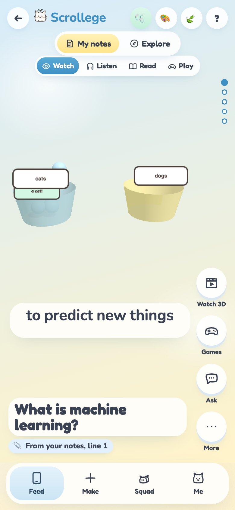
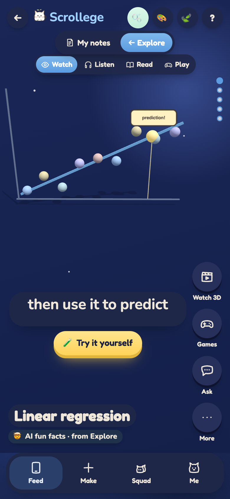
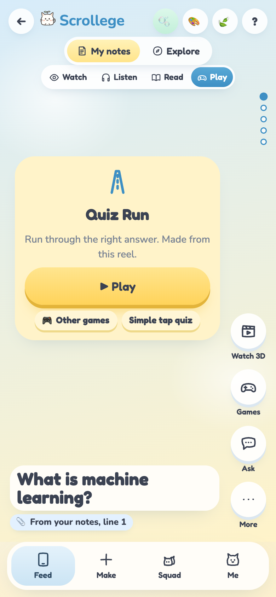
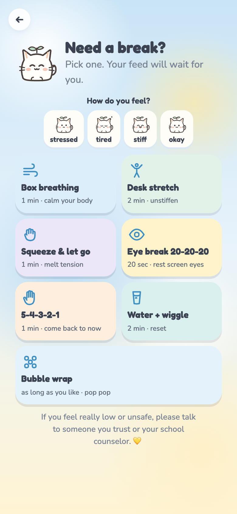
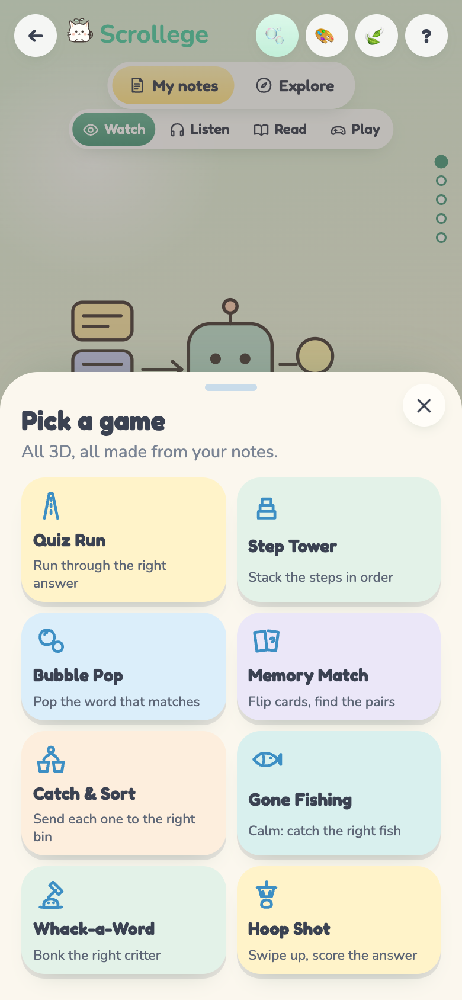
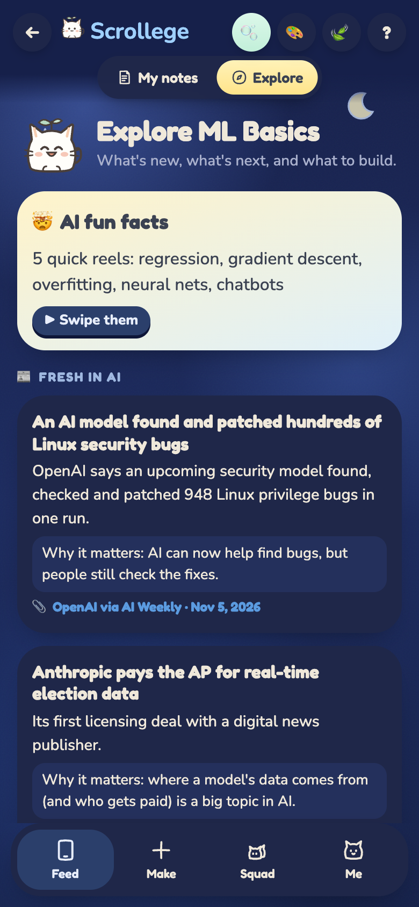
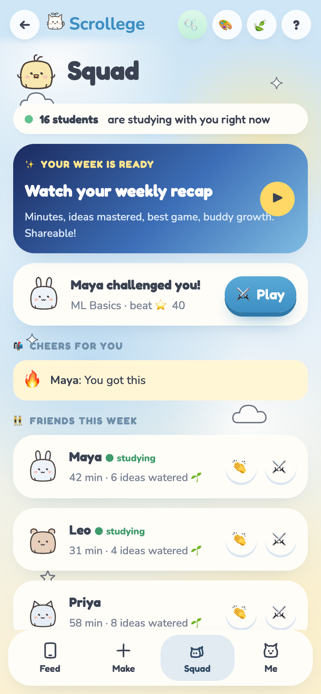
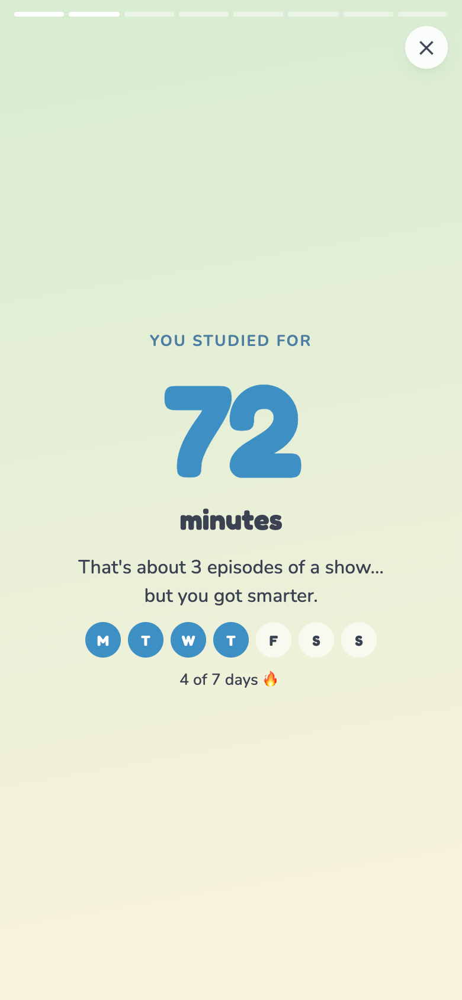
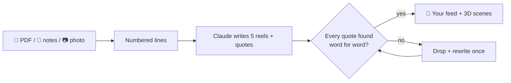

<div align="center">


# Scrollege 🫧

### Doomscrolling, but you actually pass.

Drop your class notes, a PDF or a photo. Get a TikTok-style feed with **live 3D scenes**, mini-games, a real narrator voice
and meme cards, all made from **your** material and shaped around **your** brain.
Built for ADHD, dyslexic and autistic students first, and friendly for everyone.

<!-- LIVE-LINK:START -->
### 🌐 Try it: **[scrollege.vercel.app](https://scrollege.vercel.app)**

<a href="https://scrollege.vercel.app"></a>

📱 Scan with your phone camera, then **Share → Add to Home Screen** (iPhone) or **Install app** (Android).<br>
Works on phones and laptops, installs like a real app, and the sample decks keep working offline.
<!-- LIVE-LINK:END -->

</div>

<p align="center">
  
  
  
  
  
</p>

---

## 🏆 60-second tour (for judges)

1. **Open the link or scan the QR.** Pick a look (☁️ Sky, 🌿 Sage, 🌙 Ink night) and answer 2 tiny questions. Scrolly sets up brain modes for you.
2. **📱 Feed → 👀 Watch:** every reel is a **live 3D scene that acts out each caption line**: "dots on a graph" → dots pop in, "find the best line" → the line wiggles into place.
3. **🎧 Listen:** a mini podcast with karaoke words, read by a **natural Cartesia voice**. Tap ⏸ to pause.
4. **🎮 Play:** each reel has its **own 3D mini-game** (8 in total). Wrong answers come back later, so you actually learn them.
5. **🧭 Explore:** AI fun facts, fresh AI news with sources, next topics and starter projects. Try the **🧪 Fit-the-line lab**.
6. **🫧 (top bar):** feeling stressed? Box breathing, a desk stretch, an eye break, bubble wrap… gentle and never timed.
7. **Finish a feed** and flip a **🃏 meme card**. Then open **👯 Squad** and your **✨ weekly recap**.

> The public demo uses the built-in sample decks so it's free to try. Run it with your own key to turn **any PDF, notes or photo** into a feed.

---

## 🤔 Why Scrollege?

Studying apps usually ask you to change your brain to fit the app. Scrollege does it the other way round.

| Most study apps | Scrollege |
|---|---|
| A wall of text | 5 snack-size reels. One short caption at a time |
| Still pictures | **Live 3D scenes** that act out every sentence |
| One way to learn | 👀 Watch · 🎧 Listen · 📖 Read · 🎮 Play, on every reel |
| AI that sometimes makes stuff up | **Every fact is checked against your notes word for word** and shows its page or line 📎 |
| Robot voice | A warm, natural narrator (falls back to your device's best voice) |
| Infinite scroll, streak guilt | A daily limit, a pet that naps (never dies), a celebration at the end |
| Same screen for everyone | Calm mode, easy-read font, bionic reading, line ruler, tints, no-timer mode… |

---

## ✨ What it can do

### 🍳 Cook a feed from anything
- **📄 PDF:** read right in your browser, page by page. Scanned PDFs get read by AI vision. Only the text is sent, never the file.
- **📝 Notes:** paste them in.
- **📷 Photo:** snap your notebook or a textbook page.

Scrolly turns it into **5 reels**, each with captions, bullet points, a mini podcast, a story version, a quiz, a jingle,
a 3D scene, memory-match words and a source chip.

### 🎬 Live 3D reels
Every caption line is a "beat" with its own animation, so **the picture always matches the sentence**. 10 scenes cover the big ML ideas:
sorting into bins, features → labels, clustering, train/test splits, classification vs regression, best-fit lines,
gradient descent, overfitting, neural networks and next-token prediction. Tap **🎬 Watch 3D** for the full-screen version with narration.

### 🧠 Brain modes (the quiz sets them for you)
| If studying is hard because… | Scrollege turns on |
|---|---|
| 🚀 Getting started | "Just 1 reel", study with Scrolly (a body double) |
| 🔤 Walls of text | Listen first with karaoke words, easy-read font, line ruler |
| 🔊 Noise and surprises | 🍃 Calm mode: no motion, no sounds, slower beats, "Next: …" preview |
| ⏱ Timers and pressure | No-timer mode. The 3D games wait for you |
| ✍️ Writing | Answer by voice |
| 🌎 English is new | Translate any deck |

No diagnosis needed. Students pick what's true for them, and can change anything in **🧸 Me**.

### 🎮 8 tiny 3D games, made from your notes
**Quiz Run · Step Tower · Bubble Pop · Memory Match · Catch & Sort · Gone Fishing · Whack-a-Word · Hoop Shot.**
In 🎮 Play mode each reel features a different one, and there's always a **simple tap quiz** for accessibility.
Every 3D action also has a big on-screen button, so keyboards and screen readers work too.

**🧪 Fit-the-line lab:** tap to add dots and watch real least-squares math fit a line live. Add a weird dot and see what an outlier does.

### 🗣 A voice that sounds human
Read aloud, 🎧 Listen, 🎬 Watch 3D and the break steps use a natural **Cartesia** voice. Narrator vibes change its mood
(😌 Chill, 📣 Hype, 🧸 Cozy, 🎮 Gamer), and ⏸ pauses it anytime. Soft, musical click sounds and lo-fi game music round it out.

### 🫧 Need a break?
Box breathing, a desk stretch, squeeze & let go, a 20-20-20 eye break, 5-4-3-2-1 grounding, water + wiggle, and bubble wrap to pop.
Tell Scrolly how you feel and it suggests one. Every step can be paused or skipped; nothing is timed against you.

### 🧭 Explore
🤯 AI fun facts reels, 📰 fresh AI news with a "why it matters" line and a source link, 🧭 next topics, and 🛠 beginner projects with steps.

### 🃏 Meme cards, 👯 Squad and ✨ weekly recap
Finish your feed, flip an original funny-but-true study card for your binder. Squad shows friends, cheers and duels,
and the weekly recap is a story-style look back at your week. *(Squad and the recap show sample friends and numbers in this version: no accounts yet.)*

### 🎨 Three looks
☁️ Sky, 🌿 Sage and 🌙 Ink night: soft watercolor backgrounds with little doodles. Switch any time with 🎨.

<p align="center">
  
  
  
  
  
  
</p>
<p align="center">
  
  
  
</p>

---

## 🛡 Never makes things up

Scrollege is built so the AI can't sneak in facts that aren't in your notes:

1. Your notes are split into numbered lines (or pages for a PDF).
2. Claude writes the reels **and** has to copy, word for word, the line that backs up each fact.
3. Our code checks every quote against your notes. Any reel with a made-up quote is thrown away and rewritten once.
4. 💬 Ask only answers from your notes. If the answer isn't there, Scrolly says so instead of guessing.



---

## 🚀 Run it yourself

```bash
npm install
npm run dev        # http://localhost:5173
```

It works straight away in **demo mode** with the sample *ML Basics* deck. No keys needed.

To cook real decks from your own notes, put your keys in `.env.local` (git-ignored, never uploaded) and set `DEMO_MODE=false`:

| Key | What it's for | Where to get it |
|---|---|---|
| `ANTHROPIC_API_KEY` | Turning notes, PDFs and photos into decks; Ask; Teach Scrolly | [console.anthropic.com](https://console.anthropic.com) → API Keys |
| `CARTESIA_API_KEY` *(optional)* | The natural narrator voice | [play.cartesia.ai](https://play.cartesia.ai) → API Keys |

`sh scripts/set-keys.sh` saves the Anthropic key for you with hidden typing. Restart `npm run dev` after changing keys.

### 📱 On your phone
- Open [scrollege.vercel.app](https://scrollege.vercel.app) / scan the QR code at the top, then **Share → Add to Home Screen** (iPhone) or **Install app** (Android), or
- with `npm run dev` running, open the **Network** address Vite prints (same Wi-Fi).

---

## 🔐 Keeping keys (and wallets) safe

**Claude:** the public demo runs in `DEMO_MODE=true`, so it uses no Claude key at all. If you add one to a hosted copy:
daily caps per visitor (`AI_DAILY_PER_PERSON`, default 20 turns) and in total (`AI_DAILY_TOTAL`, default 300),
an optional `AI_ACCESS_CODE` so only your link gets real AI, and a monthly spend limit in the Anthropic Console as the hard stop.

**Cartesia voice:** built to stay on the free plan with lots of testers.
- Each sentence becomes one cached clip that's **shared with everyone** through Vercel's cache, so repeats cost nothing.
- Strict daily caps: `TTS_DAILY_CHARS_PER_PERSON` (default 2,500) and `TTS_DAILY_CHARS_TOTAL` (default 15,000).
- If Cartesia is slow, out of credits or failing, the app **switches to the device's own voice automatically** and stops asking Cartesia for the day.
- Keep your Cartesia account on the free plan **without a payment method**, and it can't charge you anything.

Keys only ever live in `.env.local` and in Vercel's hidden settings, never in the code or on GitHub.

---

## 🧩 Build on it

| I want to… | Do this |
|---|---|
| Add a fun-facts pack | Drop a JSON file in [`public/packs/`](public/packs/) (copy `ai-fun-facts.json`) and list it in `index.json` |
| Add a 3D scene | Add a kind to `V3K` in [`src/app.js`](src/app.js) with one action per beat, then add it to the `v3` list in [`api/_lib/deck.ts`](api/_lib/deck.ts) |
| Add a mini-game | Add it to `GAMES` and `playGame()` in `src/app.js` (the 8 games are good templates) |
| Add a break activity | Add a row to `RELAX` in `src/app.js`: steps are `[text, seconds]` |
| Add a look | Add it to `LOOKS` and `deco()` in `src/app.js` and give it an `html.th-…` block in [`src/styles.css`](src/styles.css) |
| Change what the AI writes | Prompts live in [`api/deck.ts`](api/deck.ts); the deck shape is the Zod schema in `api/_lib/deck.ts` |
| Add an AI feature | Copy [`api/jingle.ts`](api/jingle.ts): `guard()` → `aiBudget()` → `structured()` |

```
index.html          app shell
src/app.js          the app: onboarding, feed, live 3D, games, breaks, Explore, cards, Squad, Me
src/styles.css      the approved design + phone/desktop layout
src/api.js          talks to /api (falls back to demo offline)
src/store.js        on-device saving + spaced review
api/*.ts            source · deck · ask · teach · jingle · translate · tts (Vercel functions)
public/packs/       ready-made reel packs (JSON)
tests/              Playwright (phone in 3 looks + desktop, axe, mockup match) and unit tests
reference/          the approved mockups and build prompts
DECISIONS.md        every design and build decision, in plain words
```

### Tests
```bash
npm test            # grounding check, spaced review, AI limits
npm run test:e2e    # Playwright: every mode, all 10 3D scenes, all games, breaks, voice + pause, accessibility, mockup match (muted)
```

### Updating the live site
The live site is connected to this repo: **every push to `main` deploys to [scrollege.vercel.app](https://scrollege.vercel.app) automatically**.

---

## 🔬 Why it works (in plain words)

- **Retrieval practice:** quizzes, games and Teach Scrolly make you pull an idea out of your head, which helps it stick better than re-reading.
- **Spaced repetition:** reels you miss or save come back tomorrow, then in 3 days, then a week.
- **Pictures + words:** every idea comes with a moving 3D scene, a voice, a game or a story, not just text.
- **Healthy sticky:** a daily limit and a celebration at the end, instead of endless scrolling.

---

## 🛠 Made with

Vanilla HTML/CSS/JS + [Vite](https://vite.dev) · [three.js](https://threejs.org) · [pdf.js](https://mozilla.github.io/pdf.js/) ·
[Claude](https://www.anthropic.com) (Sonnet for decks and photos, Haiku for quick answers) · [Cartesia](https://cartesia.ai) voice ·
Vercel · WebAudio for sounds and music.

Privacy: no accounts, no ads. Your notes, decks and settings stay on your device.
