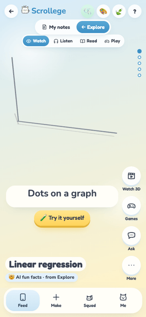
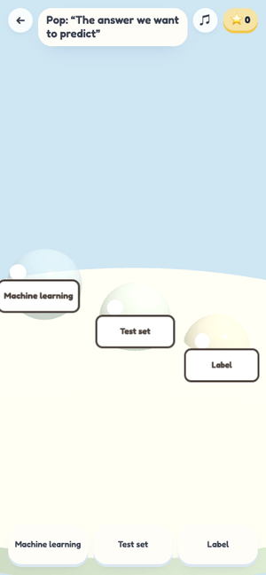
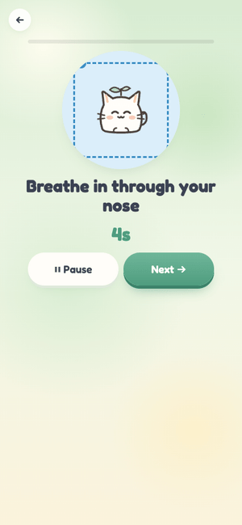
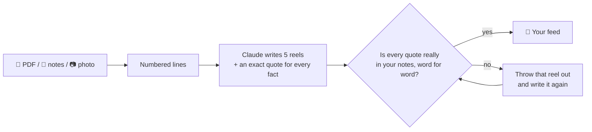

<div align="center">


# Scrollege

**Doomscrolling, but you actually pass.**

You were going to scroll anyway. Might as well be your bio notes.

[**▶ Open the app**](https://scrollege.vercel.app) &nbsp;·&nbsp; works on your phone and laptop &nbsp;·&nbsp; no sign-up

<a href="https://scrollege.vercel.app"></a>

<sub>Point your phone camera at it, then <i>Add to Home Screen</i>. It installs like a real app.</sub>

<br><br>


&nbsp;&nbsp;

&nbsp;&nbsp;


</div>

---

## So, why does this exist?

Here's how studying goes for a lot of us. You open your notes. You read one line. Your phone buzzes. Forty minutes later you know
everything about a stranger's sourdough starter and nothing about photosynthesis.

TikTok isn't magic. It's just really good at short, moving, personal, rewarding. Notes are long, still, the same for everyone, and boring.
So we flipped it: **keep the part that grabs your brain, swap in your actual class material, and end like a good teacher instead of an infinite feed.**

And because "just focus harder" has never once worked for anyone with ADHD, dyslexia or a brain that hates noise and surprises,
Scrollege is built for those brains first. Everyone else gets a nicer app for free.

---

## Try it in 60 seconds

1. Open [scrollege.vercel.app](https://scrollege.vercel.app). Pick a look and answer two tiny questions about how you like to learn.
2. Watch a reel. The 3D scene isn't decoration: it acts out each caption, line by line.
3. Tap 🎧 Listen. A warm narrator reads it, and the words light up karaoke-style. ⏸ when you need to.
4. Tap 🎮 Play. Every reel turns into its own little 3D game made from that exact idea.
5. Feeling fried? Hit 🫧 in the corner for a two-minute break that's actually good for you.
6. Get to the end of the feed. Flip the card. Laugh a little. Go to bed.

<sub>The public link runs on built-in sample decks (Machine Learning basics + AI fun facts) so it's free for everyone to poke at.
Run it with your own key and it turns any PDF, notes or photo into a feed.</sub>

---

## Everything inside

<table>
<tr>
<td width="50%" valign="top">

### 📚 Turn your stuff into a feed
- Upload a **PDF** (read right in your browser), paste **notes**, or snap a **photo** of a notebook page
- Scanned PDFs with no text? AI reads the page pictures
- Out come **5 snack-size reels**: captions, bullets, a mini podcast, a story version, a quiz, a jingle and a 3D scene
- Every reel says where it came from: *"From bio-ch4.pdf, page 3"*
- Saved on your device. Come back tomorrow, it's still there

</td>
<td width="50%" valign="top">

### 👀 🎧 📖 🎮 Learn it your way
- **Watch:** live 3D scenes that act out every sentence (10 of them, from best-fit lines to neural nets)
- **Listen:** a two-character mini podcast with karaoke words and narrator vibes: chill, hype coach, cozy, gamer
- **Read:** short bullets, *Simpler please*, bionic reading, a line ruler, read aloud
- **Play:** a different mini-game on every reel, plus a simple tap quiz if 3D isn't your thing
- **🎬 Watch 3D:** the full-screen version, narrated

</td>
</tr>
<tr>
<td valign="top">

### 🎮 8 tiny 3D games
Quiz Run · Step Tower · Bubble Pop · Memory Match · Catch & Sort · Gone Fishing · Whack-a-Word · Hoop Shot

All built from *your* deck. Get one wrong and it sneaks back in at the end, because that's how you actually learn it.
Keyboard, swipe or big on-screen buttons, and no-timer mode makes every game wait for you.

Bonus: the **🧪 Fit-the-line lab**. Tap dots onto a graph and watch real math fit a line in real time.
Then add a weird dot and watch everything get dramatic.

</td>
<td valign="top">

### 🤖 A study buddy that doesn't make stuff up
- **💬 Ask Scrolly** answers only from your notes, with the line it came from. Not in your notes? It says so instead of guessing
- **🧑‍🏫 Teach Scrolly:** explain it like Scrolly is five, get 1–3 stars and a kind hint
- **🎵 Jingles:** turn a fact into a two-line song with a lo-fi, pop or lullaby beat
- **📖 Story mode**, **🌎 translate** (Spanish, Chinese, Vietnamese, Hindi, Arabic) and **🔁 review tomorrow**

</td>
</tr>
<tr>
<td valign="top">

### 🧠 Built for different brains
No diagnosis needed. A tiny quiz picks good defaults, and you can change anything later.

| If this is hard… | Scrollege helps with… |
|---|---|
| Getting started | "Just 1 reel", study with Scrolly (a body double) |
| Walls of text | Listen first, easy-read font, line ruler, tints |
| Noise and surprises | 🍃 Calm mode: no motion, no sounds, a "next up" preview |
| Timers | No-timer mode, everywhere |
| Writing | Answer by voice |
| English is new | Translate any deck |

Plus big text, bionic reading, and **Scrollege Jr** for younger kids.

</td>
<td valign="top">

### 🫧 Feel okay
The 🫧 button is on every screen. Tell Scrolly how you feel and it suggests a break:

box breathing · desk stretch · squeeze & let go · 20-20-20 eye break · 5-4-3-2-1 grounding · water + wiggle · bubble wrap (yes, real popping)

Each one is a few short steps, read out loud, pause or skip anytime. Nothing is timed against you.
And if things feel heavier than a break can fix, it gently points you to a trusted adult or your school counselor.

</td>
</tr>
<tr>
<td valign="top">

### 🌱 Sticky, but the healthy kind
- A **daily limit** (5 reels by default), then a celebration instead of "one more"
- **Spaced review:** missed reels come back tomorrow, then in 3 days, then a week
- A **study buddy pet** that grows from egg to graduate as you learn. It naps when you're away. It never dies. No guilt streaks
- **🃏 Meme cards:** finish a feed, flip an original funny-but-true study card, collect them in your binder
- **✨ Weekly recap:** a story-style look back at your week
- **👯 Squad:** friends, cheers and duels *(sample friends for now, real accounts come later)*

</td>
<td valign="top">

### 🧭 Explore
For when you're done with your notes but still curious:
- 🤯 **AI fun facts** reels (gradient descent, overfitting, how chatbots write…)
- 📰 **Fresh AI news** with a plain "why it matters" line and the source
- 🧭 **Next topics** to learn, and 🛠 **starter projects** like "sleep vs grades" or a mini spam detector

### 🎨 Make it yours
Three watercolor looks: ☁️ Sky, 🌿 Sage and 🌙 Ink night. Pick Mochi the chick or Pickle the frog as your buddy.
Soft musical clicks, lo-fi game music, phone haptics. All of it switches off with one tap.

</td>
</tr>
</table>

---

## A peek

<p align="center">
  
  
  
  
  
  
</p>
<p align="center">
  
  
  
  
  
</p>

---

## How we keep the AI honest

Study apps that invent facts are worse than no app. So Scrollege has a rule: **no quote, no reel.**



That check is plain code, not another AI promising it was careful.
Ask Scrolly follows the same idea: it answers from your notes or it says it doesn't know.

---

## Under the hood

- **Front end:** plain HTML, CSS and JavaScript with Vite. No framework. An installable PWA that works offline with the sample decks
- **3D:** three.js. One live scene at a time, cleaned up as you scroll, so phones stay fast
- **AI:** Claude (Sonnet builds decks and reads photos, Haiku answers quick questions), with structured outputs and the quote check above
- **Voice:** Cartesia for the narrator. Every clip is cached and shared, so it stays on the free plan, and it falls back to your device's voice if anything hiccups
- **Sounds:** made live with WebAudio. No audio files
- **Privacy:** no accounts, no ads, no tracking. Your notes and settings stay on your device
- **Tested:** 76 automated tests on phone sizes in all three looks plus desktop, including accessibility checks and all 10 3D scenes

---

## Run it yourself

```bash
npm install
npm run dev        # → http://localhost:5173
```

It runs right away with the sample decks. To cook decks from your own notes, add keys to `.env.local` (never committed) and set `DEMO_MODE=false`:

| Key | What it unlocks | Get one at |
|---|---|---|
| `ANTHROPIC_API_KEY` | Turning PDFs, notes and photos into decks · Ask · Teach | [console.anthropic.com](https://console.anthropic.com) |
| `CARTESIA_API_KEY` *(optional)* | The natural narrator voice | [play.cartesia.ai](https://play.cartesia.ai) |

<details>
<summary><b>Keeping keys (and wallets) safe on a public link</b></summary>

- The public demo uses no Claude key at all (`DEMO_MODE=true`).
- If you add one: daily caps per visitor and in total, an optional access code (`AI_ACCESS_CODE`) so only your link gets real AI, and a spend limit in the Anthropic Console as the hard stop.
- Cartesia: each sentence is generated once and shared from Vercel's cache, with daily caps (`TTS_DAILY_CHARS_PER_PERSON`, `TTS_DAILY_CHARS_TOTAL`).
  If it's slow, out of credits or failing, the app switches to the device voice on its own. Keep the account on the free plan with no card and it can't charge you.

</details>

<details>
<summary><b>Build on it</b></summary>

| I want to… | Look here |
|---|---|
| Add a fun-facts pack | Drop a JSON file in [`public/packs/`](public/packs/) and list it in `index.json` |
| Add a 3D scene | Add a kind to `V3K` in [`src/app.js`](src/app.js) (one action per caption line), then list it in [`api/_lib/deck.ts`](api/_lib/deck.ts) |
| Add a mini-game | `GAMES` + `playGame()` in `src/app.js`. The 8 games are good templates |
| Add a break activity | One row in `RELAX`: steps are `[text, seconds]` |
| Add a look | `LOOKS` + `deco()` in `src/app.js`, and an `html.th-…` block in [`src/styles.css`](src/styles.css) |
| Change what the AI writes | [`api/deck.ts`](api/deck.ts) (prompt) and `api/_lib/deck.ts` (deck shape) |

```
src/app.js       the app        api/*.ts       Vercel functions (deck, ask, teach, jingle, translate, tts)
src/styles.css   the look       public/packs/  ready-made reel packs
tests/           Playwright + unit tests       DECISIONS.md   every decision, in plain words
```

Tests: `npm test` (quote check, review timing, AI limits) and `npm run test:e2e` (the whole app, muted).
Every push to `main` deploys to [scrollege.vercel.app](https://scrollege.vercel.app) on its own.

</details>

---

## Why it works (no made-up stats, promise)

- **Pulling an idea out of your head beats re-reading it.** That's why every reel ends in a quiz, a game or "teach it back".
- **Spacing beats cramming.** Things you miss come back on another day, not five minutes later.
- **Pictures plus words beat words alone.** Every idea gets a moving scene, a voice or a story.
- **Stopping is a feature.** A daily limit and a real ending, so you close the app feeling done, not drained.

<br>

<div align="center">

Made with too much bubble tea, three.js, [Claude](https://www.anthropic.com) and [Cartesia](https://cartesia.ai).


**[Go scroll something useful →](https://scrollege.vercel.app)**

</div>
