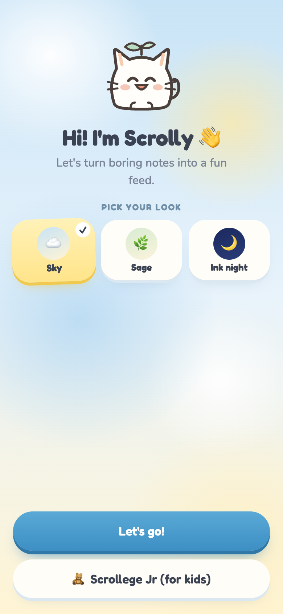
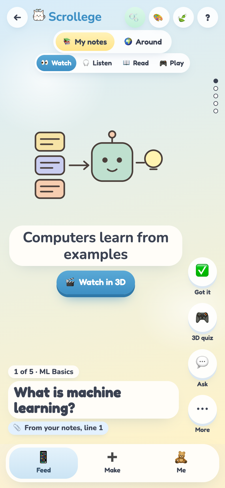
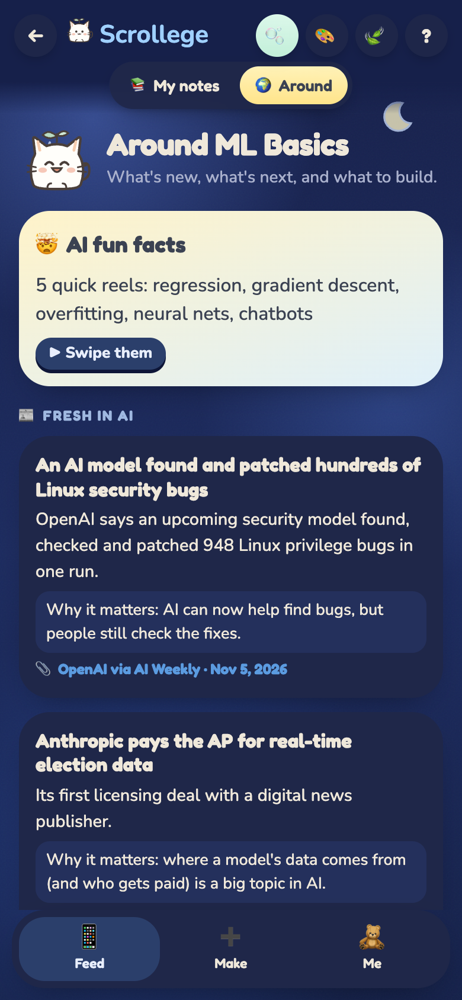
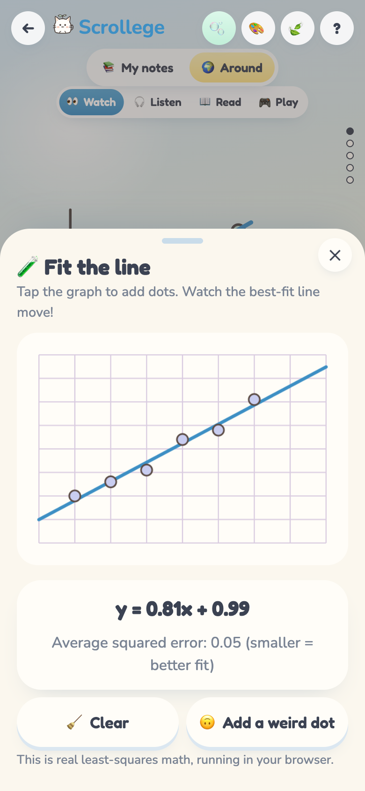
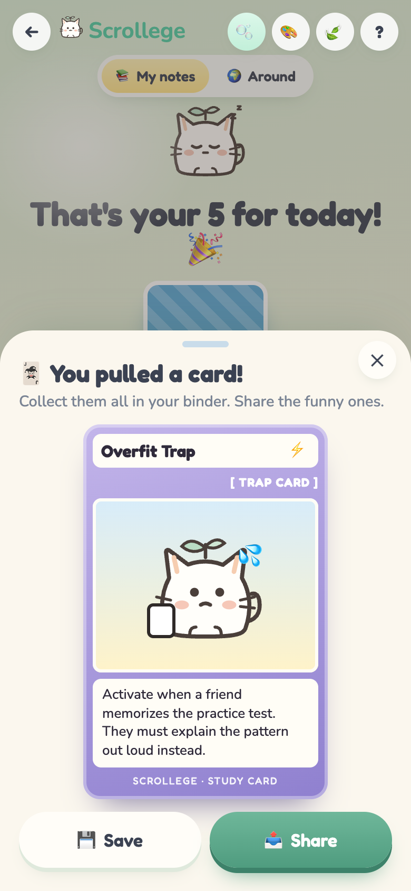
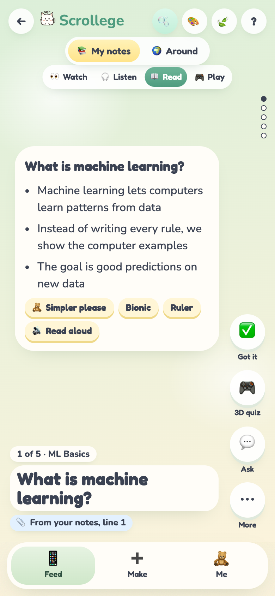
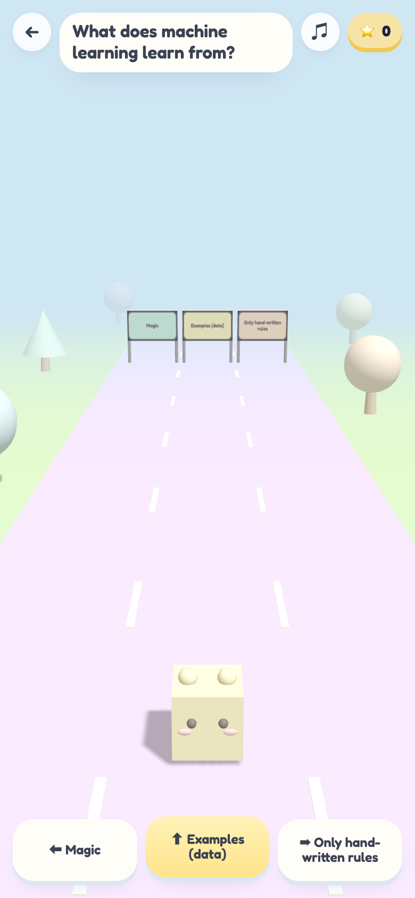
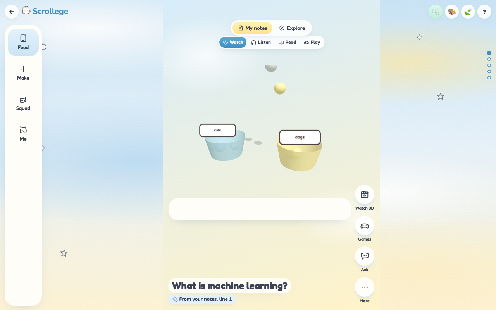
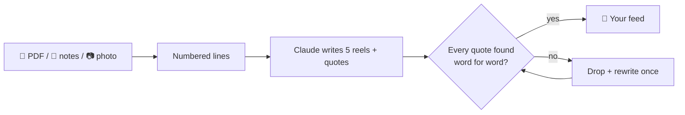

<div align="center">


# Scrollege 🫧

### Doomscrolling, but you actually pass.

Drop your class notes, a PDF or a photo. Get a TikTok-style feed, 3D games and meme cards made from **your** material,
shaped around **your** brain. Built for ADHD, dyslexic and autistic students first, and friendly for everyone.

<!-- LIVE-LINK:START -->
### 🌐 Try it: **[scrollege.vercel.app](https://scrollege.vercel.app)**

<a href="https://scrollege.vercel.app"></a>

📱 Scan with your phone camera, then **Share → Add to Home Screen** (iPhone) or **Install app** (Android).<br>
The public demo runs on the sample decks, so it's free to play with. Run it yourself with your own key to cook real decks.
<!-- LIVE-LINK:END -->

</div>

<p align="center">
  
  
  
  
  
</p>

---

## 🤔 Why Scrollege?

Studying apps usually ask you to change your brain to fit the app. Scrollege does it the other way round.

| Most study apps | Scrollege |
|---|---|
| A wall of text | 5 snack-size reels. One short caption at a time |
| One way to learn | 👀 Watch · 🎧 Listen · 📖 Read · 🎮 Play, on every reel |
| AI that sometimes makes stuff up | **Every fact is checked against your notes word for word** and shows its page or line 📎 |
| Infinite scroll, streak guilt | A daily limit, a pet that naps (never dies), a celebration at the end |
| Same screen for everyone | Calm mode, easy-read font, bionic reading, line ruler, tints, no-timer mode… |

---

## ✨ What it can do

### 🍳 Cook a feed from anything
- **📄 PDF:** read right in your browser, page by page. Scanned PDFs get read by AI vision. Only the text is sent, never the file.
- **📝 Notes:** paste them in.
- **📷 Photo:** snap your notebook or a textbook page.

Scrolly turns it into **5 reels**, each with a caption, bullet points, a mini podcast, a story version, a quiz, a jingle and a source chip.

### 🧠 Brain modes (the quiz sets them for you)
| If studying is hard because… | Scrollege turns on |
|---|---|
| 🚀 Getting started | "Just 1 reel", study with Scrolly (a body double) |
| 🔤 Walls of text | Listen first with karaoke words, easy-read font, line ruler |
| 🔊 Noise and surprises | 🍃 Calm mode: no motion, no sounds, "Next: …" preview |
| ⏱ Timers and pressure | No-timer mode. The 3D games wait for you |
| ✍️ Writing | Answer by voice |
| 🌎 English is new | Translate any deck |

No diagnosis needed. Students pick what's true for them, and can change anything in **🧸 Me**.

### 🎮 Real 3D games made from your notes
- **8 tiny 3D games:** Quiz Run, Step Tower, Bubble Pop, Memory Match, Catch & Sort, Gone Fishing, Whack-a-Word and Hoop Shot. Each reel in 🎮 Play mode features a different one.
- **🏃 Quiz Run 3D:** run through the gate with the right answer. Wrong answers come back at the end (mistake replay).
- **🧱 Step Tower 3D:** stack the steps of a process in order. The camera rises with your tower.
- **🎬 Watch in 3D:** a 12-second animated scene with narration for ML ideas (best-fit lines, gradient descent, neural nets, train/test splits…).
- **🧪 Fit-the-line lab:** tap to add dots and watch real least-squares math fit a line live. Then add a weird dot and see what an outlier does.

Every 3D action also has a big on-screen button, so keyboards and screen readers work too.

### 🫧 Need a break?
One tap on 🫧 opens real, gentle body breaks: box breathing, a desk stretch, squeeze & let go, a 20-20-20 eye break,
5-4-3-2-1 grounding, water + wiggle, and a sheet of bubble wrap to pop. Tell Scrolly how you feel and it suggests one.
Every step can be paused or skipped; nothing is timed against you.

### 🧭 Explore
What's happening around your topic: 🤯 AI fun facts reels, 📰 fresh news with a "why it matters" line and a source link,
🧭 next topics to learn, and 🛠 beginner projects with steps.

### 🃏 Meme study cards
Finish your feed, flip a card. Each one is an original, funny-but-true study card (✨ spell or ⚡ trap) that goes into your binder.

### 🎨 Three looks
☁️ Sky, 🌿 Sage and 🌙 Ink night: soft watercolor backgrounds with little doodles. Switch any time with 🎨.

<p align="center">
  
  
  
</p>

---

## 🛡 Never makes things up

Scrollege is built so the AI can't sneak in facts that aren't in your notes:

1. Your notes are split into numbered lines (or pages for a PDF).
2. Claude writes the reels **and** has to copy, word for word, the line that backs up each fact.
3. Our code checks every quote against your notes. Any reel with a made-up quote is thrown away and rewritten once.
4. 💬 Ask only answers from your notes. If the answer isn't there, Scrolly says so instead of guessing.



---

## 🚀 Run it yourself

```bash
npm install
npm run dev        # http://localhost:5173
```

It works straight away in **demo mode** with the sample *ML Basics* deck. No keys needed.

To cook real decks from your own notes:

```bash
sh scripts/set-keys.sh     # paste your Anthropic key (hidden), saves .env.local
npm run dev                # restart after changing keys
```

| Key | Where to get it |
|---|---|
| `ANTHROPIC_API_KEY` | [console.anthropic.com](https://console.anthropic.com) → API Keys |

`.env.local` is git-ignored, so your key never lands on GitHub.

### 📱 On your phone
- With `npm run dev` running, open the **Network** address Vite prints (same Wi-Fi), or
- open [scrollege.vercel.app](https://scrollege.vercel.app) / scan the QR code at the top, then **Share → Add to Home Screen** (iPhone) or **Install app** (Android).

---

## 🔐 Keep your key safe on a public link

If you put your own key on a hosted copy, everyone with the link uses it. Scrollege has three layers:

1. **Daily caps** (built in): `AI_DAILY_PER_PERSON` (default 20 AI turns per visitor) and `AI_DAILY_TOTAL` (default 300 per day). A new deck costs 3 turns.
2. **Access code** (optional): set `AI_ACCESS_CODE=something-secret`. Only people who open `your-link/?code=something-secret` get real AI.
   Everyone else still gets the full app with the sample decks.
3. **The real safety net:** in the Anthropic Console set a **monthly spend limit** and use a key just for Scrollege.
   The built-in caps live in server memory and reset when the server restarts, so the spend limit is what truly stops surprises.

The public demo runs in `DEMO_MODE=true`, so it uses no key at all.

---

## 🧩 Build on it

| I want to… | Do this |
|---|---|
| Add a fun-facts pack | Drop a JSON file in [`public/packs/`](public/packs/) (copy `ai-fun-facts.json`) and list it in `index.json` |
| Add a 3D video scene | Add a `kind` in `video3d()` in [`src/app.js`](src/app.js), then add it to the `v3` list in [`api/_lib/deck.ts`](api/_lib/deck.ts) |
| Add a look | Add it to `LOOKS` and `deco()` in `src/app.js` and give it an `html.th-…` block in [`src/styles.css`](src/styles.css) |
| Change what the AI writes | Prompts live in [`api/deck.ts`](api/deck.ts); the deck shape is the Zod schema in `api/_lib/deck.ts` |
| Add an AI feature | Copy [`api/jingle.ts`](api/jingle.ts): `guard()` → `aiBudget()` → `structured()` |

```
index.html          app shell
src/app.js          the app: onboarding, feed, games, Around, cards, Me
src/styles.css      the approved design + phone/desktop layout
src/api.js          talks to /api (falls back to demo offline)
src/store.js        on-device saving + spaced review
api/*.ts            source · deck · ask · teach · jingle · translate (Vercel functions)
public/packs/       ready-made reel packs (JSON)
tests/              Playwright (phone + desktop, 3 looks, axe) and unit tests
reference/          the approved mockups and build prompts
DECISIONS.md        every design and build decision, in plain words
```

### Updating the live site
The live site is connected to this repo: **every push to `main` deploys to [scrollege.vercel.app](https://scrollege.vercel.app) automatically** (in demo mode, so it uses no API keys).

### Deploy your own copy
```bash
npx vercel link            # once
npx vercel deploy --prod   # every time you want to update the live site
node scripts/make-qr.mjs https://your-app.vercel.app   # new QR code
```
Want real AI on your copy? Add `ANTHROPIC_API_KEY` in Vercel → Project → Settings → Environment Variables,
set `DEMO_MODE=false`, and read **Keep your key safe** above first.

### Tests
```bash
npm test            # grounding check, spaced review, AI limits
npm run test:e2e    # Playwright: onboarding, all inputs, every mode, both 3D games, Around, cards, accessibility, mockup match
```

---

## 🔬 Why it works (in plain words)

- **Retrieval practice:** quizzes and Teach Scrolly make you pull an idea out of your head, which helps it stick better than re-reading.
- **Spaced repetition:** reels you miss or save come back tomorrow, then in 3 days, then a week.
- **Pictures + words:** every idea comes with a picture, a voice, a game or a story, not just text.
- **Healthy sticky:** a daily limit and a celebration at the end, instead of endless scrolling.

---

## 🛠 Made with

Vanilla HTML/CSS/JS + [Vite](https://vite.dev) · [three.js](https://threejs.org) · [pdf.js](https://mozilla.github.io/pdf.js/) ·
[Claude](https://www.anthropic.com) (Sonnet for decks and photos, Haiku for quick answers) · Vercel · the browser's own speech tools.

Privacy: no accounts, no ads. Your notes, decks and settings stay on your device.
